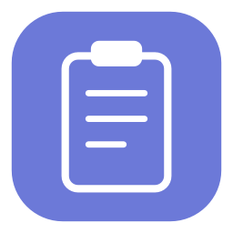
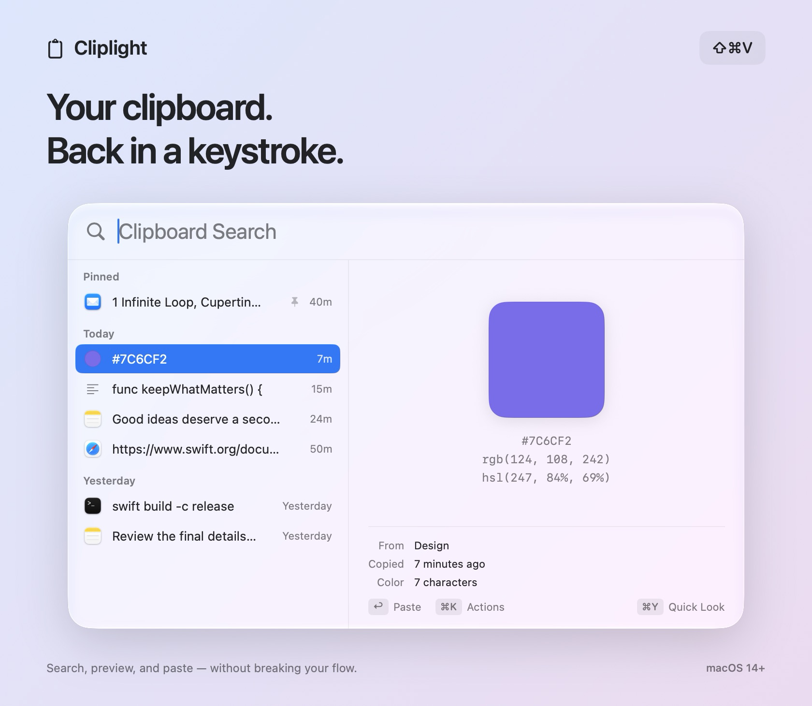
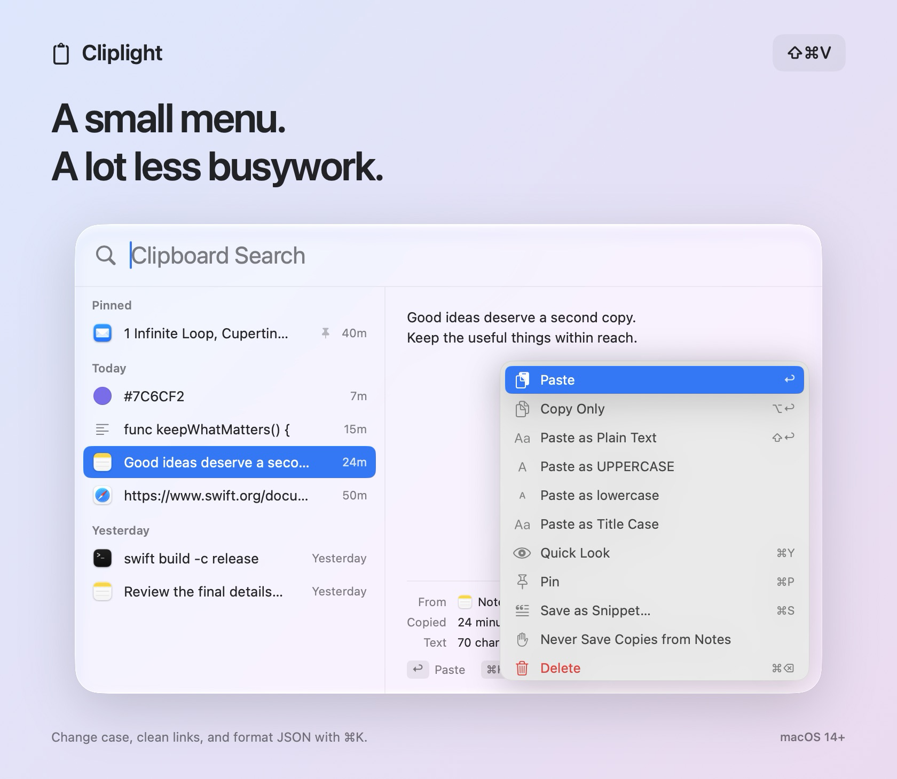
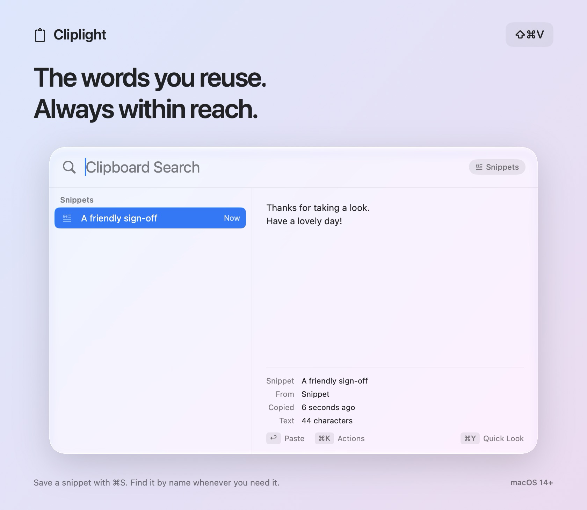

<p align="center">
  
</p>

<h1 align="center">Cliplight</h1>

<p align="center">
  <strong>A little Spotlight for everything you copy.</strong><br>
  Find that thought, link, color, or snippet. Paste it. Keep going.
</p>

<p align="center">
  <a href="https://github.com/QuantumCoderSys/cliplight/actions/workflows/ci.yml"></a>
  
  <a href="LICENSE"></a>
</p>

<p align="center">
  <a href="#getting-started">Get started</a> ·
  <a href="https://github.com/QuantumCoderSys/cliplight/releases">Releases</a> ·
  <a href="#keyboard-shortcuts">Keyboard shortcuts</a> ·
  <a href="#your-clipboard-your-mac">Privacy</a>
</p>

<p align="center">
  <picture>
    <source media="(prefers-color-scheme: dark)" srcset="docs/showcase-dark.png">
    
  </picture>
</p>

## Copy once. Find it again.

Your clipboard usually remembers one thing. Cliplight gives it a searchable history, wrapped in a familiar floating panel. Press **⇧⌘V**, type a word, and press **Return** to paste into the app you were using.

It lives in the menu bar, stays out of your Dock, and is built with SwiftUI and AppKit. No account or subscription. No third-party packages.

| A familiar place | Small details that save time |
| --- | --- |
| **Search as you type** | Find clips by their text, source app, snippet name, or text recognized in an image. |
| **See what you copied** | Preview text, syntax-highlighted code, colors, links, images, and files. History is grouped by day. |
| **Keep the useful things** | Pin important clips. Save frequently used text as named snippets. |
| **Stay on the keyboard** | Direct paste, plain-text paste, multi-select, Quick Look, and a customizable global shortcut. |
| **Make a quick fix** | Change case, trim whitespace, format JSON, or clean tracking parameters from a link with **⌘K**. |
| **Bring your other Mac** | Optionally sync pins and snippets through iCloud Drive, encrypted with your passphrase. |

## Less copying. Less cleanup.

The actions menu puts useful transformations next to the clip. Turn a sentence into a title, paste clean JSON, or copy a link without its tracking parameters. Use **Space** or **⌘Y** when you need a bigger preview; drag a clip into another app when that feels faster.

<p align="center">
  
</p>

## Keep a few good words close.

Save a signature, a friendly reply, or a recurring note as a snippet with **⌘S**. Give it a name, then search for that name whenever you need it. Snippets stay out of your everyday history until you search for them or choose their filter.

<p align="center">
  
</p>

## Getting started

**Requires macOS 14 Sonoma or later.** The release build supports Apple silicon and Intel. Liquid Glass is used on macOS 26 and later; older systems get a frosted native panel.

### Install

Signed installers will be available on the [Releases page](https://github.com/QuantumCoderSys/cliplight/releases). The first installer is currently being prepared; you can [build from source](#build-from-source) now.

When an installer is available, open the `.dmg`, drag **Cliplight** to **Applications**, and launch it. Copy something, then press **⇧⌘V**.

### First launch

- The clipboard icon in the menu bar opens your history. Right-click it for Settings, Pause Capture, and Quit.
- Direct paste needs **Accessibility** permission so Cliplight can send **⌘V** to your previous app. Without permission, the clip is copied and you can paste it yourself. Direct paste can be turned off in Settings.
- If macOS asks about clipboard access, allow Cliplight access to enable capture.
- Use Settings to record another shortcut, choose a retention period, exclude apps, or optionally open Cliplight at login.

Cliplight remembers copies made while it is running. It cannot recover earlier clipboard contents. Files are stored as references, so their originals need to stay available.

## Keyboard shortcuts

| Action | Shortcut |
| --- | --- |
| Open or close Cliplight | **⇧⌘V** — customizable in Settings |
| Search | Start typing |
| Previous / next clip | ↑ / ↓ |
| Paste selected clip(s) | Return |
| Paste as plain text | ⇧ Return |
| Copy without pasting | ⌥ Return |
| Paste result 1–9 | ⌘1 – ⌘9 |
| Select several clips | ⌘-click or ⇧↑ / ⇧↓ |
| Open actions | ⌘K |
| Quick Look | Space when search is empty, or ⌘Y |
| Pin / unpin | ⌘P |
| Save as a snippet | ⌘S |
| Delete selected clip(s) | ⌘ Delete |
| Next / previous filter | Tab / ⇧ Tab |
| Settings | ⌘, |
| Step back, clear search, then close | Escape |

## Your clipboard. Your Mac.

Cliplight works locally by default. There are no accounts, analytics, ads, or app-managed network requests. Optional iCloud Drive sync is off until you enable it.

- **Encrypted history.** Each clip is sealed with AES-256-GCM in a local SQLite database. Release builds keep the encryption key in your Mac's login Keychain. The history folder and database have user-only permissions.
- **Secret-aware capture.** Confidential, transient, and auto-generated clipboard markers are skipped. Known password-manager apps are excluded by default; you can add other apps to the never-save list.
- **Automatic expiry.** One-time codes and password-like text are detected heuristically and expire after one minute by default. You can change the interval. Pinning or saving a clip as a snippet keeps it.
- **On-device image text.** Apple Vision recognizes text in copied images on your Mac. Those images are not uploaded for recognition.
- **Optional encrypted sync.** Only pins and snippets sync. Files in iCloud Drive are encrypted with a passphrase-derived key using PBKDF2-HMAC-SHA256 with 310,000 rounds. Each Mac needs the same passphrase.
- **Your retention choice.** Keep ordinary history for a day, a week, a month, a year, or indefinitely. All clips remain subject to the storage limits: 5,000 items and 512 MB of payload.

Unmarked sensitive text can still be captured, and heuristic detection can miss secrets. Anyone using your unlocked Mac can open Cliplight. Pause capture when you need to; see [SECURITY.md](SECURITY.md) for the trust model and reporting instructions.

History lives in `~/Library/Application Support/Cliplight/`. Source-app labels are best effort and reflect the frontmost app when the copy is detected.

<details>
<summary>Uninstall and remove saved data</summary>

Quit Cliplight and delete the app. To remove saved history, delete `~/Library/Application Support/Cliplight/`. You can also remove the Cliplight items in Keychain Access. If you enabled sync, remove `iCloud Drive/Cliplight Sync/` as well.

</details>

## Build from source

Use **Swift 6** and the **macOS 26 SDK or newer**, provided by Xcode or the matching Command Line Tools. The deployment target is macOS 14. There are no external package dependencies.

```sh
git clone https://github.com/QuantumCoderSys/cliplight.git
cd cliplight
./script/build_and_run.sh
```

The script builds `dist/Cliplight.app`, signs the development bundle locally, and launches it.

```sh
./script/check.sh                   # 15 checks against the real sources
./script/build_and_run.sh --verify  # Build, launch, and check the process
./script/release.sh                 # Universal release artifacts; see RELEASING.md
```

Development builds use their own database, `history-dev.sqlite`, and a user-only development key file. Release builds use `history.sqlite` and the Keychain. Local ad-hoc rebuilds can require Accessibility permission to be granted again.

### Inside Cliplight

| Area | Source |
| --- | --- |
| Floating panel, actions, keyboard, Quick Look | [`PanelController.swift`](Sources/Cliplight/Services/PanelController.swift) |
| Clipboard capture and restoration | [`ClipboardMonitor.swift`](Sources/Cliplight/Services/ClipboardMonitor.swift) |
| Global shortcut | [`HotKeyManager.swift`](Sources/Cliplight/Services/HotKeyManager.swift) |
| Encrypted persistence | [`HistoryDatabase.swift`](Sources/Cliplight/Stores/HistoryDatabase.swift), [`Keychain.swift`](Sources/Cliplight/Services/Keychain.swift) |
| History, retention, snippets | [`ClipboardStore.swift`](Sources/Cliplight/Stores/ClipboardStore.swift) |
| Content types and transformations | [`Models`](Sources/Cliplight/Models) |
| Image text recognition | [`ImageText.swift`](Sources/Cliplight/Services/ImageText.swift) |
| Optional sync | [`SyncService.swift`](Sources/Cliplight/Services/SyncService.swift) |

The [showcase renderer](tools/showcase) uses the actual app views with isolated, fictional sample content. It never polls your clipboard or loads personal history.

## Contribute

Bug reports, thoughtful feature ideas, and pull requests are welcome. Start with [CONTRIBUTING.md](CONTRIBUTING.md). For release packaging, signing, and notarization, see [RELEASING.md](RELEASING.md).

## License

[MIT](LICENSE) © 2026 Sarthak Rawool.
